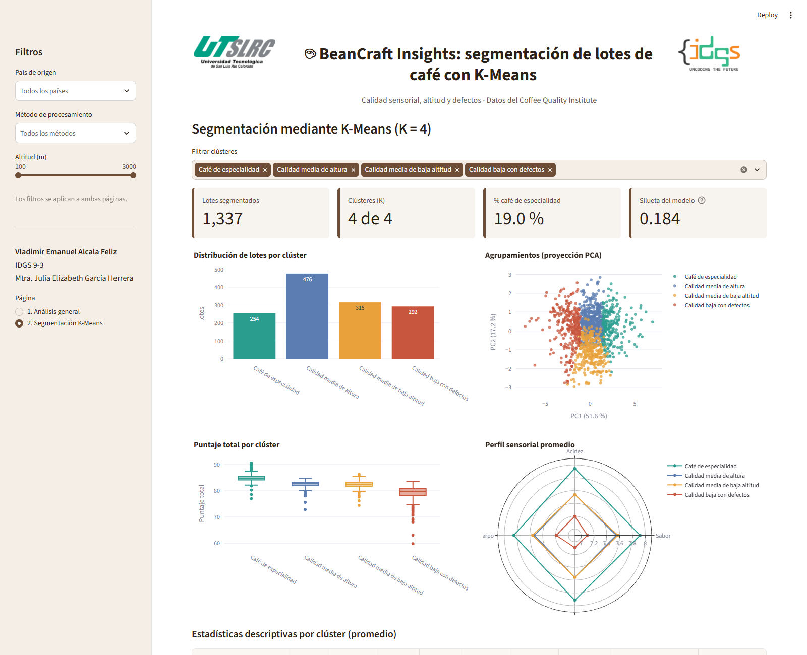

# ☕ BeanCraft Insights: segmentación de lotes de café mediante K-Means y dashboard interactivo

Proyecto integrador · Tercera unidad · Minería de datos
**Alumno:** Vladimir Emanuel Alcala Feliz · **Grupo:** IDGS 9-3 · **Docente:** Mtra. Julia Elizabeth Garcia Herrera
Universidad Tecnológica de San Luis Río Colorado

## Descripción
Se segmentan **1,337 lotes de café** evaluados por el Coffee Quality Institute usando el algoritmo no supervisado **K-Means**, a partir de su calidad sensorial (sabor, acidez, cuerpo, balance), altitud y defectos. Se identificaron **4 perfiles**:

| Clúster | Lotes | Rasgo principal |
|---|---|---|
| Café de especialidad | 254 | Mejor perfil sensorial (~7.9), puntaje 84.9, 2.4 defectos por lote |
| Calidad media de altura | 476 | Sensorial medio, altitud ~1,520 m, 4.2 defectos por lote |
| Calidad media de baja altitud | 315 | Sensorial medio, altitud ~830 m, 2.0 defectos por lote |
| Calidad baja con defectos | 292 | Sensorial ~7.1, 7.4 defectos por lote |

Resultados del modelo (K = 4): silueta 0.184, Davies-Bouldin 1.52, Calinski-Harabasz 393. Se compararon K = 4 y K = 3 (ver documento PDF).

## Dataset
*Coffee Quality Database* (CQI), distribuido en TidyTuesday (2020-07-07): `coffee_ratings.csv`, 1,339 registros y 43 variables.
Fuente: https://github.com/rfordatascience/tidytuesday/tree/main/data/2020/2020-07-07

## Herramientas
Python 3, Pandas, NumPy, Scikit-learn, Matplotlib, Seaborn, Streamlit, Plotly, ReportLab.

## Estructura del repositorio
```
├── README.md
├── requirements.txt
├── assets/                       # logotipos institucionales
├── data/
│   ├── raw/coffee_ratings.csv           # dataset original
│   └── processed/coffee_clusters.csv    # dataset procesado con clúster asignado
├── src/
│   ├── analisis_kmeans.py        # EDA, limpieza, K-Means, resultados y gráficas
│   └── generar_pdf.py            # genera la documentación en PDF
├── dashboard/app.py              # dashboard interactivo (Streamlit)
├── outputs/                      # métricas, centroides y tablas (CSV / JSON)
└── docs/
    ├── Documentacion_Proyecto.pdf
    ├── figuras/                  # gráficas del análisis
    └── capturas/                 # capturas del dashboard
```

## Cómo ejecutar
```bash
pip install -r requirements.txt

# 1) Análisis completo (regenera dataset procesado, métricas y gráficas)
python src/analisis_kmeans.py

# 2) Dashboard interactivo
streamlit run dashboard/app.py      # abre http://localhost:8501

# 3) (Opcional) Regenerar el PDF
python src/generar_pdf.py
```
Ejecutar siempre desde la raíz del repositorio. Los resultados son reproducibles (`random_state=42`).

## Dashboard
- **Página 1 · Análisis general:** 4 KPI, histograma de puntaje, top de países, altitud vs. puntaje, puntaje por proceso y estadísticas descriptivas.
- **Página 2 · Segmentación K-Means:** 4 KPI, distribución por clúster, dispersión PCA, caja de puntaje, radar sensorial, tabla de estadísticas por clúster, descripción de grupos, hallazgos y recomendaciones.
- **Filtros** (ambas páginas): país, método de procesamiento y rango de altitud (+ filtro de clústeres en la página 2).


